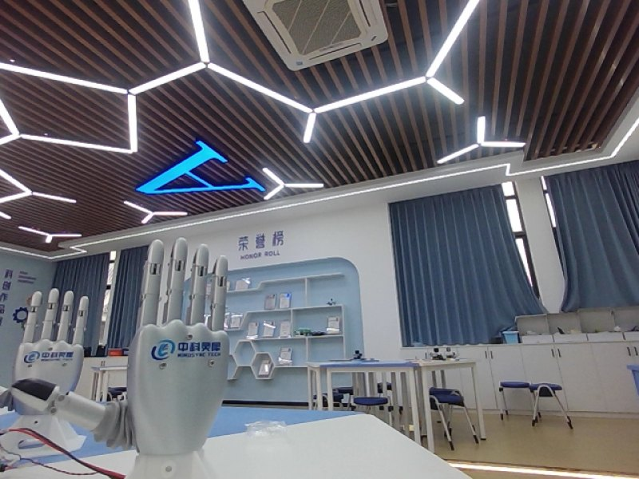
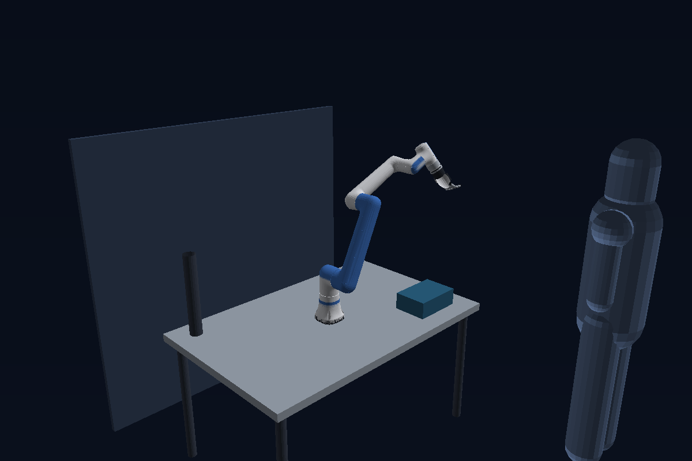
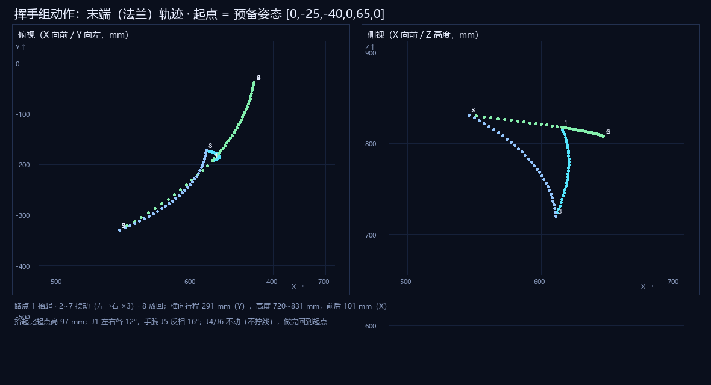

# handlink —— 中科灵犀 LG-603 灵巧手 + 越疆 Nova 5 协作臂

把一台灵巧手（和一条协作臂）变成**可以编程、可以录制、可以分析**的对象：点位、动作、
状态、传感器数据都走同一套接口。手走 CAN，臂走网口，两条链路互不影响。

> 现状（2026-11-15）：**臂已接真机跑通**（见第 8 节）；手这边本机当前没插 GCAN
> USB-CAN，跑在**仿真总线**上，但 CAN 那套早前已在真手上验证过（见第 7 节）。

---

## 1. 现在就能做的事（不需要硬件）

| 能力 | 说明 |
| --- | --- |
| 点位读写 | 与厂家 `points/*.txt` **字节级一致**（`[{"motorId":103,...}]` 紧凑 JSON） |
| 动作读写 | 与 `tracks/动作一.txt` 一致（`points=[...] / delays=[...] / loops=N`） |
| 安全检查 | 按手册表 3 校验位置/速度/电流，越界直接拦截，大步长给警告 |
| 仿真手 | 一阶位置伺服 + 电流估算，能跑姿态、动作、录制、分析 |
| 录制分析 | JSONL 录制，输出行程、峰值速度、电流占用、异常计数 |
| 麦克风 | 列设备 / 实时电平 / 录 WAV，`USB2.0 PC CAMERA` 自带的麦直接能用 |
| 数据手套 | MotionVenus 的 UDP 帧 → 六指角度（关节链求和 + 自动零点），跟手 / 代码模式可切 |
| HTTP 接口 | 本地 JSON API，供脚本 / Agent / Notebook 调用 |
| 环境探测 | 扫描串口、ZLG CAN 适配器、视觉推理服务、软件包位置 |

## 2. 目录

```
handlink/
  spec.py       电机规格、姿态模型、安全检查
  screw.py      LG-603 CAN 协议（帧构造/解析，float 小端）
  canbus.py     真机客户端：后台收包线程 + HandBus 适配层
  poses.py      预设动作组（角度表来自实测）
  store.py      点位/动作文件读写（厂家格式）
  bus.py        总线抽象 + 仿真手 + 动作播放
  arm.py        协作臂驱动：Dobot Nova 5（TCP 29999）+ 仿真臂
  arm_actions.py 组动作：一串关节路点 + 停顿（挥手示例），路点相对起点算
  arm_feed.py   臂的 30004 实时反馈解析（V4.6，小端 1440 字节，只读）
  kin.py        Nova 5 正运动学（官方 URDF 关节原点）+ 限位
  armview.py    /arm3d 三维页面（原厂 STL + 工位 + 安全间距 + 碰撞代理）
  cell.py       安全环境：工位几何、胶囊代理、最小间距、路径校验、SSM
  scene.py      相机实时环境：桌面单应、像素→基座、物体表（TTL）、合并进 cell
  boxcv.py      只认位置：高饱和立方体 → 底边接触点 → 基座坐标（不读 9 格）
  pick.py       抓取流程：到位 → 合手 → 抬升（含互锁）
pickbox.py    定位后安全抓取：目标从场景来、按手算高度、逐段查碰撞
  hardware.py   串口 / ZLG CAN 驱动封装、环境探测
  recorder.py   JSONL 录制与离线分析
  camera.py     摄像头采集（MJPEG / 设备探测）
  glove.py      数据手套：MotionVenus UDP 收帧 + 六指换算（服务内置）
  audio.py      麦克风：列设备 / 电平 / 录 WAV
  vision.py     手部识别（MediaPipe）
  service.py    HTTP JSON 服务
  webui.py      /demo 网页
  cli.py        命令行
  static/nova/  Nova 5 原厂 STL（7 段）+ 胶囊代理 proxies.json
scripts/        can_watch / hand_live / hand_gesture / can_capture
                arm_up（臂接管+使能）/ classdump + jar_scan（协议逆向工具）
                build_nova_assets.py（STL → 碰撞胶囊代理）
tests/          321 个测试，离线全绿（含 glove 的 37 个、scene 的 21 个、pickbox 的 14 个）
demo/           HTTP 演示、演示录制数据
pkg/
  LG-603/       厂家运行时（自带 JRE、点位、动作）
  vendor-jar/   从 exe 里解出来的 cable-driven.jar（协议逆向依据，39 MB）
```

## 3. 快速开始

```bash
python -m handlink scan                      # 这台电脑有什么硬件
python -m handlink limits                    # 电机限位表（来自手册）
python -m handlink points                    # 厂家的点位
python -m handlink pose --point rock --wait 2
python -m handlink track 动作一 --dry-run    # 只看时间线，不动
python -m handlink track 动作一 --scale 10   # 仿真里播一遍（10 倍速）
python -m handlink record --out demo/run.jsonl --point rock --seconds 2
python -m handlink analyze demo/run.jsonl --markdown
python -m handlink serve --port 8766         # 起 HTTP 服务
python -m handlink serve --glove             # 顺手把数据手套（UDP 5001）也收上
python -m handlink serve --arm 192.168.5.1   # 起服务并接上协作臂（三维视图跟随真机）
python -m handlink arm                       # 仿真臂状态（不接真机）
python scripts/arm_up.py                     # 真臂：只读看模式/位姿/关节角
python scripts/arm_up.py --yes               # 真臂：接管 TCP + 使能（默认 20% 速度）
python -m handlink.arm_feed 192.168.5.1      # 真臂：30004 实时反馈摘要
python -m handlink pick --preview            # 抓取流程要走的距离/耗时
python -m handlink pick                      # 整条抓取流程离线跑一遍
python demo/http_demo.py                     # 一键演示全部接口
python -m handlink selftest                  # 跑测试
python -m handlink mic                       # 列麦克风（不连服务）
python -m handlink mic --test --seconds 2    # 试录 2 秒，看峰值
```

## 4. 网页演示

```bash
python -m handlink serve --port 8766
```

> 端口以 **8766** 为准（旧版是 8765，仍在跑就改成 8766 或直接 `--port` 指定别的；
> 插件会自动往后找空闲端口，页面顶部显示的就是实际端口）。

然后打开 <http://127.0.0.1:8766/demo>：可以拖滑块逐指下发、点石头/剪刀/布、
随机抓握、播放动作、开关录制并当场看分析表；右边是接口日志，每次操作都对应一条
真实的 HTTP 调用。页面上的手是 `/state` 的实时映射。

页面右上角有 **「连接机械手」** 按钮：点它才会去开 CAN 适配器（等价于
`POST /hand/attach {"bus":"can"}`），连上后徽章变绿写「已连接 · can 0x64」，
下面一行写帧数 / 校准状态；掉线后按钮变回「连接机械手」，再点一次就是重连。
徽章的判断标准是**最近 3 秒内还在收帧**，不是「适配器打开过」——所以线松了、
手断电了会立刻变红。

摄像头实时画面在 <http://127.0.0.1:8766/camera>：MJPEG 直出，不依赖任何前端库，
右边能切设备 / 旋转 / 镜像 / 改分辨率，识别结果也叠在这一页上（见第 6 节）。

拿到机械手之后照着做的清单页：<http://127.0.0.1:8766/plan>
（也可以直接双击打开 `docs/plan.html`，进度存在本机浏览器）。

命令行版演示：

```bash
python demo/drive.py          # 连到上面的服务，走一遍 石头→剪刀→布→半握 并录一段
python demo/http_demo.py      # 自己起服务、调接口、打印结果、关闭
python demo/render_poses.py   # 把姿态渲染成 demo/poses.png（需要 Pillow）
```

## 5. HTTP 接口

默认监听 `127.0.0.1:8766`，请求/响应都是 JSON。

| 方法 | 路径 | 说明 |
| --- | --- | --- |
| GET | `/health` | 服务状态 |
| GET | `/limits` | 电机限位/电流表 |
| GET | `/hand/status` | 手连上没有：`connected` / `bus` / `frames` / `hand_id` / `calibrated` / `detail` |
| POST | `/hand/attach` | 运行时连手 `{"bus":"can"}`；`{"bus":"sim"}` 切回仿真；连不上自动退回仿真并回 422 |
| GET | `/state` | 六指实时状态 |
| GET | `/points` `/points/<name>` | 点位列表 / 单个点位 |
| GET | `/tracks` `/tracks/<name>` | 动作列表 / 单个动作 |
| GET | `/actions` | 预设动作组清单 |
| POST | `/action` | 跑动作组 `{"name": "fist"}` |
| POST | `/pose` | 下发姿态 `{"motors": [...], "reason": "..."}` |
| POST | `/point` | 套用点位 `{"name": "rock"}` |
| POST | `/track` | 播放动作 `{"name": "动作一", "scale": 1.0, "dry_run": false}` |
| POST | `/stop` | 停止动作并回零（真机是就地定住） |
| POST | `/record/start` `/record/stop` | 录制开关 |
| POST | `/analyze` | 分析录制文件 `{"path": "demo/run.jsonl"}` |
| GET | `/glove/state` | 手套监听状态、模式、帧率、六指实时角度 |
| POST | `/glove/start` | `{"udp":5001,"side":"right","gain":1}` 开监听；端口被占回 422 |
| POST | `/glove/stop` | 关监听（手的姿态停在最后一帧） |
| POST | `/glove/mode` | `{"mode":"glove"}` 跟手 / `{"mode":"code"}` 隔断 |
| POST | `/glove/toggle` | 在两种模式之间翻转 |
| POST | `/glove/zero` | 把当前姿态记成摊平零点 |
| POST | `/glove/gain` | `{"gain":1.2}` 调手套→电机行程的增益 |

摄像头（`/camera` 页面对应的接口）：

| 方法 | 路径 | 说明 |
| --- | --- | --- |
| GET | `/camera` | 实时画面网页 |
| GET | `/camera.mjpg` | MJPEG 流，可直接 `` |
| GET | `/camera/state` | 帧率、分辨率、错误、识别状态 |
| GET | `/camera/devices` | 物理设备 + 能出图的（后端, index）组合 |
| GET | `/camera/snapshot.png` | 当前一帧的干净 PNG |
| POST | `/camera/open` | `{"index":2,"backend":"msmf","width":640,"height":480,"rotate":0,"mirror":false}` |
| POST | `/camera/close` | 关掉设备 |
| POST | `/camera/detect` | `{"enable":true,"every":6}` 开关识别 |

麦克风（`/camera` 页面右下角的卡片）：

| 方法 | 路径 | 说明 |
| --- | --- | --- |
| GET | `/audio/devices` | 录音输入设备（index / 名字 / 声道） |
| GET | `/audio/state` | 录音状态、实时电平（dBFS）、已录时长 |
| GET | `/audio/clips` | 录过的 WAV 列表 |
| GET | `/audio/file/<name>` | 取一段 WAV（浏览器直接播） |
| POST | `/audio/start` | `{"index":0,"seconds":8}` 开录 |
| POST | `/audio/stop` | 停录，返回路径 / 时长 / 峰值 |
| POST | `/audio/test` | 试录 2 秒，回答「这个麦到底响不响」 |

协作臂（`/arm3d` 页面对应的接口，第 8 节）：

| 方法 | 路径 | 说明 |
| --- | --- | --- |
| GET | `/arm3d` | 三维机械臂页面 |
| GET | `/arm/model` | 关节原点 / 限位 / 工作半径（前端做正解用） |
| GET | `/arm/cell` | 工位几何 + 碰撞胶囊代理 + 安全阈值（页面和服务端同源） |
| GET | `/arm/state` | 关节角 + 末端位姿；`online` 决定来自真机 30004 还是仿真 |
| POST | `/arm/joints` | `{"joints":[...],"apply":false}` 设定姿态；`apply=true` 才发真机（先过安全闸门），`force=true` 跳过碰撞红线 |
| GET | `/arm/actions` | 组动作清单（挥手 / 点头示意），带默认参数 |
| POST | `/arm/action` | 跑组动作 `{"name":"wave","apply":false,"cycles":3}`；`apply=true` 且已使能才动，每段过同一道闸门 |
| POST | `/arm/check` | `{"joints":[...]}` 按 2° 采样扫整条 MovJ 路径，回最小间距/最近对象 |
| GET | `/arm/cable` | J4/J6 累计扭转、上限、基准姿态（电缆防缠） |
| POST | `/arm/cable/mark` | 把当前姿态标记为「没缠」的基准，累计清零 |
| POST | `/arm/attach` | `{"ip":"192.168.5.1"}` 重连 30004（页面上的「重连真机」） |
| POST | `/arm/enable` | `{"on":true,"speed":20}` 上/下使能；按 30004 复核，不在线 / 报警 / 急停 / 运动中拒绝 |
| GET | `/arm/poses` | 已保存的姿态（关节角 + 末端位姿 + 文件路径） |
| POST | `/arm/poses` | `{"name":"桌面抓取","joints":[...]}` 保存；`joints` 不给就存「现在这个姿态」，名字留空自动编号，重名覆盖 |
| POST | `/arm/poses/delete` | `{"name":"桌面抓取"}` 删掉一个保存的姿态 |

相机实时环境（`/arm3d` 的「相机实时环境」卡片，第 8.8 节）：

| 方法 | 路径 | 说明 |
| --- | --- | --- |
| GET | `/scene/state` | 标定残差、桌上物体、视觉延迟、单应矩阵 |
| POST | `/scene/calibrate` | 四对点标定：`{"pixels":[[u,v]×4],"world":[[x,y]×4]}`；或 `{"pixels":[...],"rotate":0,"mirror":false}` 用桌角预设 |
| POST | `/scene/place` | 手动放物体：`{"u":320,"v":240,"size":[0.06,0.06,0.06],"kind":"box"}` |
| POST | `/scene/clear` | 清空相机/手动物体（`{"source":"vision"}` 只清视觉） |
| POST | `/scene/detect` | 立刻读一次：优先读魔方 9 格；读不出就退回 `boxcv` 只给位置 |
| GET | `/camera/frame.jpg` | 干净的一帧 JPEG（桌面贴图用，约 30 KB） |
| GET | `/arm/cell?live=1` | 静态工位 + 相机看到的物体，和下发闸门同一份 |

`/scene/detect` 的返回里 `reading` 是 9 格读数，`box` 是「只定位」的兜底：
当纯色/视角不满足、`cubecv` 认不出面时，`boxcv.find_box()` 把画面里离纸/托盘
中心最近的高饱和立方体框出来，用底边接触点反投影 + 半个边长得到底面中心，写进
同一张物体表（名字仍是 `相机·魔方`，TTL 3 s）。它只要求「是个立方体」，不要求
纯色贴纸或垂直俯视；代价是只有位置，没有面状态。

### 摄像头页面怎么用

`http://127.0.0.1:8766/camera`：左边实时画面，右边设备 / 参数 / 识别。



- 设备在 OpenCV 里是「后端 + index」，**不是设备名**：同一台机器上 MSMF 和 DirectShow
  的编号不一样，插拔一次还会整体漂移。所以先点「扫描」，看哪个组合真能出图
  （能出图的排前面）；打开时如果那一路没画面，会自动换一路能出图的并回报 `used`。
- 实测这台机器的奥比 Gemini 336L RGB 是 `msmf #2`：640×480 跑满 30 fps、1280×720
  约 15 fps、1280×800 只有 8 fps（UVC 模式的限制）。深度那一路能打开但不出图，
  要用 pyorbbecsdk（只有 cp310/cp311 的轮子）。
- 装歪了拖「旋转」，装反了开「镜像」。这些设置存在浏览器里，下次自动沿用。
  （这台实验台的摄像头是倒装的，选 180° 才是正的。）
- 没有 opencv 时页面只能列设备。pip 装不上就把 wheel 解压到 `.tmp/pylibs`，
  `camera.py` 会自动找到它（也可以用 `HANDLINK_PYLIB` 指定别处）。
- 识别走 `handlink/vision.py`：现在是 MediaPipe 手部关键点（21 点 → 每根手指弯曲量），
  没装 mediapipe 就在页面上明确提示，不影响看画面；换自己的模型只要实现
  `info / detect / draw` 三个方法。

### 视觉识别（手部关键点）

页面上点「开识别」，或者直接调接口：

```bash
curl -s -X POST http://127.0.0.1:8766/camera/detect \
  -H "Content-Type: application/json" -d "{\"enable\": true, \"every\": 6}"
```

30 fps 下每 6 帧识别一次（约 5 Hz），单帧 12–20 ms（CPU）。结果三样：
21 个归一化关键点、手的包围框、**每根手指的弯曲量 0～1**（`flex`，键就是电机号
102/107/103/104/105/106）——乘上行程就是电机角度。

| 依赖 | 说明 |
| --- | --- |
| `mediapipe` | 1.x 只剩 Tasks API，模型要单独下（`handlink/models/hand_landmarker.task`，7.8 MB）；0.10.x 的老 `mp.solutions` 也兼容 |
| `opencv-python` | 已经有就不用重复装 |

两个坑已经在代码里处理掉了：这个工作区路径带中文，TFLite 的 C++ 层打不开非 ASCII
路径，`vision.py` 会先把模型拷到临时目录再加载；matplotlib 的缓存目录重定向到
`.tmp/mplcache`，不然在受限账号下 import 就会报权限错。

### 数据手套（MotionVenus）

MotionVenus 把 32 个关节的位置 + 欧拉角按 UDP 发出来（一帧拆成两个 subpackage），
`handlink/glove.py` 收下后**先减掉手腕**、再按关节链求和换算成六指角度，和 `/pose`
走同一条安全检查：

```
手套 → MotionVenus → UDP 127.0.0.1:5001 → glove.py → App.apply() → CAN / 仿真
```

```bash
python -m handlink serve --glove             # 起服务并开始收手套（默认 5001、右手、gain 1.0）
curl -s -X POST http://127.0.0.1:8766/glove/start \
  -H "Content-Type: application/json" -d "{\"udp\":5001,\"side\":\"right\",\"gain\":1}"
curl -s http://127.0.0.1:8766/glove/state    # frames / fps / live / motors / raw / hint
```

| 手套关节链（右手 0~15，左手 16~31） | 电机 | 说明 |
| --- | --- | --- |
| Thumb1 | 102 拇指1 | 只跟 CMC（拇指根），**不再和 107 重叠** |
| Thumb2..3 | 107 拇指2 | MCP + IP（两节求和） |
| Index1..3 | 103 食指 | 三节求和 |
| Middle1..3 | 104 中指 | 三节求和 |
| Ring1..3 | 105 无名指 | 三节求和 |
| Pinky1..3 | 106 小指 | 三节求和 |

换算：每节先用 ZXY 欧拉角拼出旋转矩阵，左乘手腕矩阵的转置（`R₀ᵀ·Rⱼ`）得到"相对
手腕"的旋转；**再沿这一节的屈曲轴投影**（有符号），六指各自把链上几节加起来，减掉
最近 10 秒里的最小值（摊平基线），乘 `电机上限 / 150° × 增益`。屈曲轴不是写死的，
是教出来的（见下面「教一次屈曲轴」）——没教之前退回"转角大小"，外展和拧骨头都会算
进去。满量程仍是 150° 量级，换了算法实测量会变：摊平握一次，看 `raw` 的跨度，握不满
就加增益，轻轻一动就到底就减增益。

> **2026-11-20 修的坑：手不动、手臂转一圈，大拇指自己动。** 帧里的 `ex/ey/ez` 是整只
> 手在同一参考系里的**绝对姿态**，不是相对上一节；老算法直接取 `max(|ey|,|ez|)`，
> 手臂一转这个量就跟着涨。拇指最明显，因为它的骨头几乎垂直于小臂——绕小臂的滚转在
> 四指那儿大多被吃进 roll（`ex`，本来就丢掉），到拇指就整个投影到 `ey/ez` 上；再加上
> 102（三节求和）和 107（2~3 节）算的是同一批关节，一份干扰被算了两遍（还各自乘了
> 自己的行程）。现在默认 `frame=rel` 把整只手的公共旋转除掉，`frame=abs` 只留作对照。
>
> **第二修（同一天，现场反馈"拇指变成往外展、还跟着手臂动"）**：`rel` 只消掉了"整只手
> 一起转"，但剩下那个量还是**无符号的转角大小**——拇指 CMC 的外展、拧骨头、皮肤被小臂
> 带动的自转，全被当成"弯手指"，于是"收拇指"变成了"拇指往外展"。两处一起改：
> ①每节沿**学出来的屈曲轴**做有符号投影，非屈曲方向的转动直接投影掉；
> ②拇指拆成 102←Thumb1、107←Thumb2..3，CMC 一动不再同时推两个电机。

- **教一次屈曲轴**（换人/换手/重戴之后都要重教，2 秒）：
  ```bash
  curl -s -X POST http://127.0.0.1:8766/glove/teach -d '{"action":"start"}' -H "Content-Type: application/json"
  # 四指慢慢握到底、拇指往掌心弯（别外撇），2~3 秒
  curl -s -X POST http://127.0.0.1:8766/glove/teach -d '{"action":"stop"}' -H "Content-Type: application/json"
  ```
  返回里 `axes` 就是学到的每节屈曲轴，存在 `handlink/config/glove_axes.json`，下次启动
  自动加载。`action:"status"` 看当前轴、`"clear"` 清掉。某一节没转起来会在 `skipped`
  里列出来，那节继续用无符号兜底。
- **自动零点**：不用按键，摊平 1~2 秒自己归零；换了手、重新戴，`POST /glove/zero`
  立刻把当前姿态记成 0。
- **跟手 / 代码模式**：`POST /glove/mode {"mode":"code"}` 之后手套照收但不下发，
  滑块、点位、动作脚本可以独占手；`{"mode":"glove"}` 一帧就接管回来。
- **换换算方式**：`frame=rel`（默认，减手腕）／`rel-ext`（另一种 ZXY 读法）／`abs`
  （老算法，只做对照）。`POST /glove/frame {"frame":"rel-ext"}` 立刻换（顺手清基线），
  命令行是 `serve --glove --glove-frame rel-ext`。
- **现场怎么量**：`python tools/glove_probe.py --seconds 20` —— 手指张开别动、只转手臂，
  它把三种换算各算一遍，输出每根手指的波动范围和"合计"，最小的那套就是你这副手套该
  用的。`--selftest` 不用手套也能验这套分析（合成帧里 rel 必须是 0）。
- **死区**：`POST /glove/deadband {"deadband":{"102":5,"107":6}}` 给指定电机抹掉几度；
  拇指残抖就靠它，别超过 10°（再大就觉得"捏不紧"）。
- **零点：粘性地板**（实时任务用）。老规则"最近 10 秒最小值"在任务里很危险：任何一次
  下冲都会立刻变成新零点，接下来 10 秒整只手偏高——抓握中的表现就是"手突然合了一下"。
  现在往下要**连续低于 0.25 s** 才认（单帧毛刺不算），往上要贴着基线 6 s 之后才按
  2°/s 慢慢追（只管温度漂移，不会把抓握里的量一点点吃掉）。`POST /glove/zero` 立刻重设。
- **运行时看得见**：`/glove/state` 里 `spikes`（跳上去又弹回，传感器松/丢包）、
  `saturated`（顶到电机行程，点位会被夹）、`frame_age_s` + `live`（掉线）——任务中
  判断"这一帧能不能信"就看这三项。
- **跑任务时记录**：`python tools/glove_soak.py --seconds 180` 只读 `/glove/state`，
  任务照常跑，结束给一张小结（掉线秒数、毛刺次数、饱和时长、帧率）+ CSV 明细。
- **延迟不累积**：每轮先把 socket 里积压的包全收完、只用最新一帧，再按 `rate`
  （默认 50 Hz）限流下发。
- **独立跑法**：`tools/glove_bridge.py` 现在只是 `handlink.glove` 的薄壳，
  服务没起、或要转发给别的程序时照样能用。
- **插件里已经内置**：DSH 侧栏「机械手」→「数据手套」卡片，见
  [handlink-plugin/README.md](handlink-plugin/README.md)。

#### 摆姿态存点位（把某次摆好的姿态固定下来）

有些动作只想要"就这个姿态"：用手套摆出来，存成点位，之后按点位确定性回放——整条
链路不用手写角度。（实时跟手是另一条路：手套一直在环里，见上面的运行时那几条。）

```bash
# 1) 手套摆好（手指到位就行，手臂怎么放都行）
curl -s -X POST http://127.0.0.1:8766/glove/save -H "Content-Type: application/json" \
  -d '{"name":"pen-grasp"}'
# → {"motors":{"102":..,"107":..},"saturated":[],"issues":[],"path":".../points/pen-grasp.txt"}

# 2) 回放看效果
curl -s -X POST http://127.0.0.1:8766/point -H "Content-Type: application/json" \
  -d '{"name":"pen-grasp"}'

# 3) 哪根指头差几度，就地改：写回点位 + 立刻下发
curl -s -X POST http://127.0.0.1:8766/point/nudge -H "Content-Type: application/json" \
  -d '{"name":"pen-grasp","delta":{"107":-5,"102":3}}'
```

- `glove/save` 取最近 5 帧的**中位数**（`"frames":10` 可调）。手套自身抖动 ±2~3°，抓
  单帧等于把这一下抖存进点位。
- `saturated` 非空 = 手套读数顶到电机上限，这个点位会被夹住，换个稍小的姿态重存。
- 臂的姿态用现成的 `POST /arm/poses` 存；"接近位（臂）+ 抓握（手）"两个点位合起来就是
  一个动作，不写代码也能拼。

> **抓笔这类动作，拇指轴要按"对掌"教**：`102` 只跟 Thumb1，教的时候把手势做成"拇指
> 转到对侧、去捏食指指腹"（握笔的样子），别用"拇指往掌心弯"。轴是从手势里**学**出来的，
> 手势定义了这个电机代表什么；用屈曲手势教、却要它对掌，等于让它做它没有的自由度。

### 识别机械手本体（模板锚点）

MediaPipe 是人手专用模型，对着机械手跑出来一定是 0 个手——别指望它。要定位机械手用
模板锚点这条路：页面上点「框住机械手」，再点一下画面里的手掌，之后每帧用
`matchTemplate` 在整幅图里找这块手掌。

```bash
curl -s -X POST http://127.0.0.1:8766/camera/track \
  -H "Content-Type: application/json" -d "{\"x\":250,\"y\":180,\"w\":140,\"h\":110}"
curl -s -X POST http://127.0.0.1:8766/camera/detect \
  -H "Content-Type: application/json" -d "{\"enable\":true,\"mode\":\"robot\",\"every\":3}"
```

返回掌心坐标和置信度（低于 0.45 判为不在画面里）。模板取的是**手掌**，所以手指张合
不影响匹配：实测把整帧平移 (35, 25) 后掌心跟着挪 35/25 像素、把手掌以上全涂掉，两次
置信度都是 1.00。代价是相机不能动——动了就重新点一次手掌。

### 麦克风

新接的 `USB2.0 PC CAMERA` 自带麦克风，系统里显示成「麦克风 (USB2.0 MIC)」，是录音
设备 `#0`（主板上那个是「2- Realtek(R) Audio」`#1`）。`/camera` 页右下角的「麦克风」
卡片可以选设备、看实时电平、试录 2 秒、录一段存成 WAV：

```bash
curl -s http://127.0.0.1:8766/audio/devices     # 有哪些输入设备
curl -s http://127.0.0.1:8766/audio/state       # 录制中：level_db / seconds
curl -s -X POST http://127.0.0.1:8766/audio/test \
  -H "Content-Type: application/json" -d "{\"index\":0,\"seconds\":2}"
# → {"ok":true,"seconds":1.95,"peak_db":-41.9,"signal":"有声音",...}
```

- 录音走 Windows 的 `winmm`（`waveIn*`，`handlink/audio.py`），不需要 sounddevice /
  pyaudio；16 kHz 单声道 16 bit，存到 `pkg/LG-603/recordings/audio-*.wav`
  （和动作录制同一个目录，`/audio/clips` 一起列出来）。
- 电平条是 50 ms 一块的 RMS 映射到 -60～0 dBFS；正常说话大概 -45～-20 dB，掉到
  -55 dB 以下基本就是静音或没选对设备。
- 单次最长 120 秒，`/audio/start` 的 `seconds` 可以调短；忘了停会在到点时自动停。
- 打不开先查系统「隐私和安全性 → 麦克风」有没有禁用应用访问，再看是不是被会议软件占着。
- 这台机器上它和摄像头是同一个设备，只是分成了两路：视频 `msmf #1` 640×360@30，
  音频 `waveIn #0`。视频编号插拔一次会漂，音频编号按 winmm 枚举顺序走，
  所以页面上都按名字认。

预设动作组见 `handlink/poses.py`：`open` 张开、`fist` 握拳、`point` 食指指、
`pinch` 捏、`grip` 握拳→张开、`count` 数数 1-2-3、`fan` 开合三次。

`/pose` 的返回里带 `issues`（安全提示）和 `held`（本次没动、保持原位的电机）。

```bash
curl -s -X POST http://127.0.0.1:8766/pose -H "Content-Type: application/json" \
  -d "{\"motors\":[{\"motorId\":103,\"angle\":120,\"speed\":60,\"torque\":0.5}],\"reason\":\"test\"}"
```

## 6. AI 控制（自然语言 → 动作）

```bash
python -m handlink ai "先张开，再握拳，然后食指指一下"
python -m handlink ai "轻轻捏住，保持两秒" --dry-run
```

模型只允许调用**技能白名单**（张开/握拳/捏/剪刀/指/指定角度/保持），不直接写角度；
越界会被夹到限位，一次最多 12 步、8 秒。接自己的大模型：

```bash
set HANDLINK_LLM_BASE=https://api.deepseek.com/v1
set HANDLINK_LLM_KEY=sk-xxx
python -m handlink ai "抓一下" --llm
```

HTTP：`POST /ai {"text": "..."}`、`GET /ai/skills`。详细说明见
[AI控制接入指南.md](AI控制接入指南.md)。

## 7. 接真机（已打通，CAN）

厂商软件 `LG-603.exe` 是 exe4j 打包的：要求管理员权限，而且按**相对路径**加载 native
库（必须在 `pkg\LG-603` 目录里启动，否则 `UnsatisfiedLinkError`）。我们不再需要它——
协议已经从它解出来的 `cable-driven.jar` 里反汇编出来了。

```bash
python -m handlink serve --bus can          # 起服务，直接驱动真手
# 浏览器打开 http://127.0.0.1:8766/demo
```

**硬件**：GCAN USBCAN-I（`VCI_OpenDevice` 设备类型 4、通道 0、1000 kbps），
`ECanVci64.dll` 用 ctypes 直接调。**同一时刻只有一方能占用适配器**，厂商软件开着就不能连。

**协议**（`handlink/screw.py`，从 `ScrewCommandUtils` 的字节码常量读出来的）：

| 帧 | 含义 |
|---|---|
| `[func][node][payload]` | 主机 → 电机，标准帧，ID = 手部 ID（0x64/0x65） |
| `[func+1][node][seq][float32 LE]` | 电机 → 主机，7 字节应答 |
| `[0x05][node][count][calib][run]` | 心跳 5 字节，`calib&0x08` = 校准成功，`run` 位掩码 |

`func`：`0xA2` 位置 / `0xA4·0xA6·0xA8` 读位置·速度·电流 / `0xD0` 电流 / `0xE0` 速度 /
`0xF2` 使能 / `0xA0` 校准 / `0x0E` 清错。**float 是小端**（源码里显式 `LITTLE_ENDIAN`）。

三个实测坑：

1. 手每秒灌约 3000 帧心跳，**必须常开收包线程**，否则驱动接收缓冲满了 `Transmit` 会阻塞；
2. 电流低于 0.8 A 时多指同动会触发 I-LIM 卡在中途（`canbus.py` 默认 1.0 A）；
3. 拇指电流上限 0.8 A、其余 3.5 A，超了会被 `spec.check` 静默拒绝。

## 8. 协作臂（Dobot Nova 5，TCP/IP）—— 已接真机

2026-11-15 实测接通。臂和手是两条独立链路，臂走网口，手走 CAN。

| 项目 | 实测 |
| --- | --- |
| 控制柜地址 | `192.168.5.1`，29999 控制口 / 30004 反馈口 / 502 Modbus 都开着 |
| PC 侧 | USB 网卡「以太网 2」静态 `192.168.5.100/24`（DSC 不做 DHCP，不配就停在 169.254） |
| 反馈口 | 30004，**小端**，固定 1440 字节/包，实测约 125 帧/秒 |
| 上电初态 | 控制模式**不是 TCP**，所有 Dashboard 指令（连 `GetPose()`）都回 `Control Mode Is Not Tcp` |

三步上线（`scripts/arm_up.py` 把顺序和每一步的校验写死了）：

```bash
python scripts/arm_up.py                         # 只读：当前模式 / 位姿 / 关节角
python scripts/arm_up.py --yes --speed 20        # RequestControl → SpeedFactor → EnableRobot
python -m handlink arm --ip 192.168.5.1 --check  # 复核：RobotMode + GetPose + GetAngle
python scripts/arm_nudge.py --joint 1 --delta 3 --yes   # 试动：J1 转 3° 再回原位
python scripts/arm_demo.py --yes                 # 演示：J1 左右摆 + 手腕上下 + 肘收放
python scripts/arm_wave.py                       # 组动作「挥手」：只打印路点和间距
python scripts/arm_wave.py --yes --cycles 3      # 组动作「挥手」：真跑，做完回原位
python scripts/arm_down.py --yes                 # 收工：Stop() + DisableRobot()
```

实测：下使能 → 使能位置变化 **0.02 mm**；`MovJ(joint=…)` 让 J1 ±3°，0.6 s 到位，
来回一趟回到原点偏差 **0.00 mm**；收工下使能后 10 s 内位姿漂移 <0.05 mm，无报警，母线 48.1 V。

`handlink/arm_feed.py` 是 30004 的解析层，字段偏移逐条对着 V4.6 手册的表写；
`tests/test_arm_feed.py` 钉住字节序和每个偏移（10 个用例，不需要真机）。

三个坑：

1. **只有「未上电」或「下使能（非暂停、未松抱闸）」才允许切 TCP**（手册 2.1）。
   运行中/拖拽中发 `RequestControl()` 会被拒，`arm_up.py` 先看反馈再决定发不发。
2. 30004 是**小端**，且连上去的第一包大概率接在半路——`arm_feed.carve()` 用
   `MessageSize=1440` + `TestValue=0x0123456789ABCDEF` 双重对齐，接在包中间也能拉回来。
3. `BrakeStatus` 实测恒为 0（使能 / 下使能都一样），所以**别拿它判断抱闸**；
   判断「有没有抱住」只能看下使能后位姿还漂不漂。

### 三维视图 `/arm3d`（安全环境，不只是示意图）

```bash
python -m handlink serve --arm 192.168.5.1     # --arm 不给就是纯仿真
# 打开 http://127.0.0.1:8766/arm3d
```



> 图是同一套几何的**离屏渲染**（浏览器里是实时 three.js，带 HUD、碰撞代理、禁入柱和
> 最近点红线；这台机器上没法自动截 WebGL 画面，所以文档图用离线渲染出）。

- **模型**：越疆 Nova 5 的**原厂 STL**（`handlink/static/nova/`，base_link + Link1~Link6，
  来自 `nova5_2f85_description`，和 `kin.py` 的关节原点同源；螺钉、线槽、关节罩都在），
  不是胶囊拼的示意图。每段连杆挂在 URDF 正解出来的位姿上，末端接 LG-603 灵巧手
  （手掌 / 四指三节 / 拇指 / 腕部法兰，跟着 `/state` 的弯曲量动）。
- **工位**：1.4×0.9 m 桌面、料盒、相机立柱、防护栏、站在桌前的操作员、禁入柱，
  全部定义在 `handlink/cell.py` —— 页面和服务端用的是**同一份几何**。
- **碰撞代理**：`scripts/build_nova_assets.py` 把每段 STL 沿长轴切片，生成一圈胶囊
  （`static/nova/proxies.json`，71 段）。页面实时算机械臂到桌面上每样东西、
  到人、以及自身跨段（隔两段以上）的最小间距，最近的一对用红点标出来。
- **SSM**：按 ISO/TS 15066 的简化式 `S = v·t + v²/(2a) + C` 算「当前速度需要多大间距」，
  和实测间距并排显示。t/a/C 是工程假设值（`cell.ssm_required`），真机验收要重标。
- **下发闸门**：`POST /arm/check` 把 MovJ 的整条关节插值路径按 2° 采样扫一遍；
  `POST /arm/joints {apply:true}` 在服务端会**再算一次**，低于红线直接拒绝并回原因
  （`force:true` 才放行，留给现场调试）。不是只在前端做个动画。
- **手腕走线（电缆防缠）**：灵巧手是有线的，J4/J6 连续同方向转会把线拧死。
  `handlink/cable.py` 按实测角累计这两个关节的扭转，下发时把目标换成**等效角**
  （`θ` 和 `θ±360°` 是同一个姿态），优先选让累计更小的方向，并把 |累计| 限制在 ±360°
  （`HANDLINK_CABLE_LIMIT` 可调）；超了只接受能回缠的方向。页面上有「手腕走线」卡片，
  缠过线、手工理顺之后点「把当前姿态标记为没缠」（`POST /arm/cable/mark`）把基准清零。
- **两种数据源**：真机在线就每 100 ms 拉一次 30004 的关节角（「跟随真机」）；不在线退回滑块仿真。
  控制柜的 30004 对并发连接很敏感，客户端被强杀后要等一会儿，所以页面上有「重连真机」。
- **使能按钮**：页面上的「机械臂使能」卡片直接走 29999：需要时先 `RequestControl()` 接管 TCP，
  设速度因子（默认 20%，可改），再 `EnableRobot()` / `DisableRobot()`；发完用 30004 的
  `EnableStatus` 复核，不在线、有报警、急停未复位或正在运动时不会发指令。
- **渲染**：**three.js**（透视相机 + 方向光/半球光 + PBR 环境贴图 + 实时阴影 + OrbitControls）。
  库放在 `handlink/static/`（`three.module.js` 670 KB、`OrbitControls.js`、`RoomEnvironment.js`），
  页面用 importmap 引用，**不连 CDN** —— 断网也能看。
- **出图**可以用 URL 参数锁姿态：`/arm3d?joints=0,-25,-40,0,65,0`。
- **保存姿态**：「关节角」卡片下面有「保存的姿态」卡片。拖动示教掰到位（或拖滑块到目标）
  后点「保存当前姿态」存下来——跟随时存真机 30004 的实测角，手动 / 仿真时存滑块上的值，
  另外记一份末端位姿给人认。点名字回填到滑块，再走「校验 → 让真机走到这个姿态」；
  点 × 删除。存在 `handlink/config/arm_poses.json`（`HANDLINK_ARM_POSES` 可换位置），
  重名就是覆盖，重启服务不会丢。
- **强制下发（force）**：「校验后下发」卡片里除了正常下发，还有「强制下发 force」，
  等价于 `POST /arm/joints {apply:true, force:true}`：只跳过**碰撞红线**和视觉时效，
  手腕超缠、未使能、报警、运动中服务端照样拦，点之前会弹确认。

> 「要不要上 Isaac Sim / MuJoCo / CoppeliaSim」：那套适合做动力学和规划研究，但要把
> TCP 反馈、MovJ、安全闸门都搬过去。这里的折中是**真几何 + 胶囊代理 + 解析距离**做
> 在线安全监控，浏览器里 8 Hz、零依赖；真要跑抓取动力学，拿 `nova5_2f85.urdf` +
> 同一批 STL 直接进 MuJoCo/Isaac 即可，不用重画模型。

### 8.8 相机实时环境进仿真（2026-11-17）

`/arm3d` 里的工位以前是写死的；现在相机看到的桌面可以进来：

- **标定**：在 `/vision` 点「点桌面四角」，按画面左上→右上→右下→左下点四个桌角，
  解出像素→基座坐标的单应 H（4 点，不需要内参）。合成解残差 0 mm；真机看手点
  质量，预计 5～15 mm，约 2.8 mm/px（1.4 m 桌面占 ~500 px）。
- **融合**：`scene.py` 把相机读到的魔方（`cubecv`）换成基座坐标里的立方体；
  杯子/料盒在 `/vision` 点一下「点画面里的物体 → 加进仿真」，或走 `POST /scene/place`。
- **进安全模型**：`/arm/check` 和 `apply=true` 的下发闸门用的都是
  `scene.cell()`（静态工位 + 实时物体），不是只在前端画个框。
- **看得到**：`/arm3d` 里橙色方块是视觉物体、青色是手放的；桌面上还能叠一层
  相机画面（`/camera/frame.jpg` + H⁻¹ 逐顶点 UV），贴纸对上了就说明标定是对的。
- **丢帧不删**：视觉物体保留 3 s（`CUBE_TTL`）；视觉停 2 s（`VISION_STALE_S`）就判失效，
  标定过但相机没跑、或视觉失效时 `apply=true` 直接拒绝，要 `force=true` 才放行。

研究结论、方案对比、精度预算和升级路线见
[相机接入模拟.md](docs/相机接入模拟.md)；测试 `tests/test_scene.py`（19 个）。

### 8.9 定位后安全抓起盒子（2026-11-18）

`pickbox.py` 把「场景里的盒子」变成一条**先检查再执行**的抓取路径：

- **目标**：从场景物体表挑（`--from-scene`）或命令行给坐标（`--x/--y/--w/--d/--h/--yaw`）。
- **高度按手算**：法兰到指尖 185 mm，指尖停在盒子上沿下方一半（60 mm 盒子 → 30 mm），
  手指从两侧抱，不是拿法兰压桌面。
- **路径**：当前位姿 → 正上方过渡点（450 mm）→ 预抓取（盒顶 +60 mm）→ 下探 →
  合手（互锁，没合上不抬）→ 抬升 → 退回过渡点。先抬高再平移，避免直接折过去
  扫到料盒或自己的腕部。
- **每段先查**：真机用控制器的 `InverseKin`（`--arm-live`），仿真用 `kin.ik`；
  逐段折成关节角后 `cell.check_path()` 扫最小间距。抓取段阈值 10 mm（标定 3 +
  控制 2 + 余量 5），一般移动仍是 60 mm；人的禁入柱不受影响。
- **拒绝就停**：反解不出来、间距不够、手没合上，都在动作前报错，不带着问题动。

**手部碰撞模型同时细化了**（`cell.CELL["tool"]`）：原来是 3 个大胶囊、指尖半径
38 mm，抓 60 mm 盒子时模型会认为手指插进桌面；现在按厂家手部图拆成 8 段——
手掌（r 50）+ 指根横梁 + 四根细手指（r 9）+ 拇指（r 11），指尖仍在法兰下方 185 mm。
这样「指尖在桌面上方 30 mm」时模型的最低点是 21 mm，10 mm 阈值能过；合手时实际更小，
所以仍是保守包络。

实测（只读连真机，不动臂）：目标 (150, 250) mm、80×80×60 mm 时六段全部通过，
最小间距 21 mm（灵巧手 vs 桌面）；同样的盒子放到 (300, −200) 会被静态料盒挡住
（−11 mm）——说明 `CELL` 里料盒的位置和真实工位对不上，要先重标。

```bash
python -m handlink.pickbox --dry-run --arm-live --x 0.15 --y 0.25 --h 0.06
python -m handlink.pickbox --sim     --x 0.15 --y 0.25 --h 0.06
python -m handlink.pickbox --go --from-scene --hand can --yes   # 真机
```

测试 `tests/test_pickbox.py`（14 个）：反解往返、指尖高度、过渡点、阈值、手模型。

### 8.10 组动作：挥手（示例，2026-11-19）

`arm.py` 只负责「走到某个关节角」。真要给人看，得是一串带停顿的动作（抬手 → 摆几下 →
放回去）。`handlink/arm_actions.py` 就是这一层：一条组动作 = 若干
`Move(label, joints, hold_ms)`，**路点相对「现在这个姿态」算增量**，所以臂站在哪都能做，
不必先回零，做完也一定回到起点。

`wave`（挥手）只有三段意思：抬起前臂（J2 −12°、J3 +30°、手腕 J5 −16°）→ J1 左右各摆
12°、J5 反相摆 16°，摆 `cycles` 次（默认 3）→ 原样放回。以 `/arm3d` 的「预备」姿态
`[0,-25,-40,0,65,0]` 为例，末端（法兰）画出来是一条 0.8 m 高的横向扇面：



四种跑法：

| 跑法 | 命令 / 操作 |
| --- | --- |
| 网页 · 仿真先看 | `/arm3d` → 「组动作」卡片 → 点「挥手」，三维视图按路点走一遍 |
| 网页 · 真机 | 先「使能」，再点「挥手」（会二次确认，任一段不过闸门就地停） |
| 命令行 | `python scripts/arm_wave.py`（只打印路点/间距）/ `--yes`（真跑） |
| HTTP | `POST /arm/action {"name":"wave","apply":true,"speed":20}` |

有界，和 `skills.py` 一个思路：

- **只动 J1/J2/J3/J5**。J4/J6 是走线的两根关节（见 `cable.py`），组动作一律不给增量，
  从源头上不会把灵巧手的线拧死；
- 单步 ≤ 45°、停顿总量 ≤ 6 s、最多 24 段，超了 `validate()` 直接报错；
- 真机**每一段**都过同一道闸门（`App._arm_gate`：手腕防缠 + 碰撞间距 + 视觉物体时效），
  任一段不过就 `Stop()` 停在原地，响应里 `steps_done` 说明做到哪段；
- 段间默认停 0.15 s 再查下一段 —— 30004 的 `RunningStatus` 比 MovJ 的到位判据晚一点，
  不等一下下一段会被「臂正在运动」误挡（真机上就是这么卡住的）。

**加一个自己的组动作**只要两步：

```python
# handlink/arm_actions.py
def nod(start, deep_deg=22.0, beat_ms=320):                  # 1. 返回 List[Move]
    deep = _clamp_float(deep_deg, 5.0, 30.0, "deep_deg")
    base = [float(v) for v in start]
    return [at("低头", base, {5: -deep}, beat_ms),
            at("抬头", base, {5: deep * 0.6}, beat_ms),
            at("放回原位", base, {}, 0)]

ACTIONS["nod"] = {"label": "点头示意", "description": "…",      # 2. 登记，按钮名就是 label
                  "builder": nod, "defaults": {"deep_deg": 22.0, "beat_ms": 320}}
```

`GET /arm/actions` 和 `/arm3d` 的按钮区都从 `ACTIONS` 读，前端不用改。
测试：`python -m unittest tests.test_arm_actions`。

## 9. 安全红线

- 首次/改动后：速度 ≤ 60、电流 ≤ 0.3 A、**单指逐个验证方向与范围**（手册 2.2 / 2.4）。
- 电流上限：拇指 0.8 A，其余四指 3.5 A。数值越大不代表越安全。
- 出现卡滞/异响/异常电流：先 `/stop`，再排查，别连续复位（手册 3.4）。
- **未知帧格式时不要盲发 CAN**：先只读旁听。
- 动作播放会阻塞执行，服务里用后台线程并支持 `/stop` 打断。
- **臂（Nova 5）**：首次上线速度因子 ≤ 20%；示教/调试时手不进工作空间、急停伸手可及；
  双臂联调前臂和手必须各自先单独验证通过（`docs/NV050-1-对接方案.md` 第 6 节）。

## 10. 已知限制

- `WinSerial` / `ZlgCan` / `SerialTap` **未在真机验证**（本机无设备），接口按标准写。
- 没有电机帧编解码：需要第 1 步抓到的真实报文来确定。
- 仿真无力学（质量、摩擦、耦合），只用于打通链路，不能代替抓取实验。
- 麦克风只做了「录 / 听电平」：`audio.py` 走 Windows `winmm`，别的系统还不能录；
  **说话 → 动作还没接**（识别要 sherpa-onnx 之类的流式中文模型，见 `docs/现状.md` 待办 5）。
- HTTP 服务无鉴权，只绑 `127.0.0.1`；不要暴露到局域网。
- **三维安全模型是「保守近似」**：碰撞代理是 STL 切片生成的胶囊（外扩、偏保守），
  用于在线监控和下发前拦截，**不能替代现场风险评估和实测**；SSM 的 t/a/C 是工程
  假设值，真机验收要按制动距离重标。
- 自碰撞只查「隔两段以上」的连杆：相邻连杆和腕部 4/5/6 在结构上就是套在一起的，
  代理必然重叠，算进来只会得到恒定的负值。
- 操作员是一个由 8 段胶囊拼的人形，位置固定在桌前 `(0.95, -1.05)`；
  真接安全激光雷达/视觉时，把 `cell.CELL["human"]` 换成实时测到的胶囊即可。
  相机现在只能把**桌面平面**上的物体接进来（`scene.py`）；站在地上的人要先做
  内参 + 外参标定，才能从地面像素反推基座坐标，见 docs/相机接入模拟.md 第 6 节。

---

## 11. 拟真环境（2026-11-26 起：一套会「失败」的仿真）

原来的仿真只保证**流程能跑通**（记目标、立刻到达）。现在多了一层：把真机上
咬过人的行为搬进仿真——卡电流、排队、抢占、丢帧、顶桌、报警。判据很直接：
**仿真里跑绿了，真机上不该再出现同一类事故。**

```bash
python -m handlink serve --sim-arm                 # 三维视图/使能/组动作全走真 29999+30004
python -m unittest tests.test_pick_realistic -v    # 抓取在「会卡住」的手上跑
```

| 仿真器 | 是什么 | 什么时候用 |
| --- | --- | --- |
| `bus.SimBus` | 纯算术，一阶逼近，最快 | 流程编排、UI 演示 |
| `handsim.HandSim` | 梯形速度 + 电流约束 + 心跳 + 断电 | 抓取互锁、看门狗、上线自检 |
| `arm.SimArm` | 带运动学 + 虚拟时钟 + 算法队列 | 单元测试、轨迹规划 |
| `armsim.VirtualDobot` | 真 socket 的虚拟控制器（29999 + 30004） | 端到端联调、复现「连不上/被顶掉」 |

规则：**要证明一段代码在真机上不会出某类事故，用 `VirtualDobot`；只想证明逻辑对，用 `SimArm`。**
`--sim-arm` 起的实例端口由系统分配，不碰 `192.168.5.1`，现场开着真机也不会被干扰。

所有数字的出处（GetPose 3.9 ms、ServoJ ACK 6.2 ms、0.6 A 卡 118°、3000 帧/秒…）、
每个坑的触发方式，以及这套仿真**自己撞出来的两个真缺陷**——抓取互锁会放行卡在
118° 的手、`kin.ik` 对演示位姿会落进奇异支管——见 [docs/拟真环境.md](docs/拟真环境.md)。

新增回归：`test_armsim`(39) + `test_handsim`(19) + `test_arm_sim_real`(26) +
`test_pick_realistic`(6) + `test_service_sim_arm`(4) + `test_service_virtual_dobot`(4) +
`test_faults`(11)。一键自检（仿真 vs 真机数字对照）：`python scripts/sim_report.py`。

