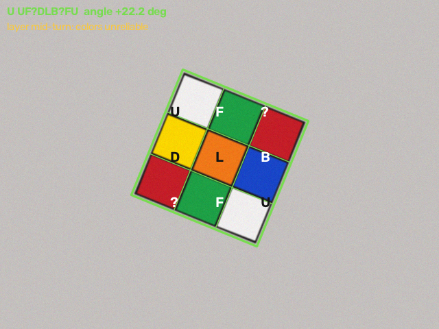

# 魔方视觉接入（2026-11-16）

一句话：**俯视相机已经能认出魔方朝上那面的 9 格颜色和这一层转了多少度**，通过
`/vision` 页面看、通过 `/vision/*` 接口给程序用；还**没**接进臂的运动闭环，也还
没在真机上标定过（俯视相机现在没插）。

---

## 1. 现在有什么

```
handlink/cubecv.py     检测 + 读数 + 调色板/基准（纯计算，不碰相机、不碰服务）
handlink/cubeui.py     /vision 页面
handlink/camera.py     多了 mode="cube"：识别结果叠在 MJPEG 推流上
handlink/service.py    /vision、/vision/state、/vision/calibrate、/vision/quad、/vision/analyze
scripts/vision_check.py  命令行：取帧/读数/学配色/自检
tests/test_cubecv.py   10 个测试，全用合成图，不接硬件
```



实测（合成图，640×480，魔方面约 170 px）：识别一次 **90–170 ms**（中位 130 ms，
干扰物越多越慢），角度误差 **< 2.5°**，90° 整转后 9 格颜色能正确换位。
所以推流里默认每 10 帧才识别一次；闭环决策直接调 `/vision/analyze` 就行。

---

## 2. 相机怎么装

| 项 | 建议 |
| --- | --- |
| 位置 | 托盘**正上方**，镜头垂直向下；偏 10° 以内问题不大，偏多了 9 格会串 |
| 距离 | 画面里魔方边长占 **1/4 左右**（640×360 下 90–150 px，640×480 下 120–200 px） |
| 光照 | 漫射白光；**别让灯管/窗户直接反光到贴纸上**——魔方贴纸是镜面，反光会整格发白 |
| 背景 | 桌面别用纯白（白贴纸和白桌面靠颜色分不开）；托盘用深色打印件最好 |
| 相机 | `USB2.0 PC CAMERA`（640×360@30）够用；Gemini 336L RGB（1280×800@8fps）更清楚但慢 |

### 本机踩到的坑：MSMF 开不出图

同一台 USB 相机，实测有时 `msmf #0` 打得开但 **0 fps**（拿不到帧），换
`dshow #0` 就有。页面和接口都可以指定 `backend`：

```json
POST /camera/open {"index":0,"backend":"dshow","width":640,"height":360}
```

`scripts/vision_check.py --list` 会把每种后端实测一遍，挑 `frame=true` 的那个。

---

## 3. 第一次使用（网页，约 10 分钟）

```bash
python -m handlink serve --bus sim     # 只调视觉可以不带手
# 浏览器开 http://127.0.0.1:8766/vision
```

1. **打开相机**：页面自动扫能出图的设备并打开，同时把识别切成 `cube`。
2. **学调色板**（颜色准不准全靠这一步）：把复原的魔方六个面依次朝上，各选一次
   面字母、点「学习这个面的颜色」。六面学完，页面右上角会显示「已学 6/6」。
   不学也能用标准配色，但换灯光/换相机就会偏。
3. **设基准**：把魔方摆正（U 面边与托盘边平行），点「设托盘基准」。之后读到的
   `angle` 都是相对这个姿态的。
4. 之后每次看读数：左边 3×3 字母 + 中间的大角度。

**识别不稳时**先看「内线」这一项：

- `内线 ≥ 0.8`：框得很准；
- `0.65` 左右：勉强，可能是贴纸反光或格子被挡；
- `< 0.5`：基本是没框准 / 光不够 / 画面里没有魔方。

### 手动框四角（兜底）

自动检测偶尔会挑到桌上的别的方块（比如纸盒）。点「手动框四个角」，从左上开始
顺时针点 4 个角，之后就一直用这四个角，直到点「恢复自动」。

---

## 4. 读数怎么读

```json
{
  "found": true,
  "reliable": true,
  "cells": ["U","R","F","D","L","B","U","R","F"],
  "angle": 12.3,
  "ref_angle": 3.1,
  "center": [320.4, 240.1],
  "cell": 56.8,
  "gap": 1.0,
  "good": 1.0,
  "score": 1.0,
  "source": "stickers",
  "ms": 41.2
}
```

- **cells**：9 个字母，**行优先**（左上 → 右 → 下一行），和魔方界面的 3×3 一致。
  `U`=`白`、`R`=`红`、`F`=`绿`、`D`=`黄`、`L`=`橙`、`B`=`蓝`。
  认不出（颜色偏离太远）的格子给 `?`。
- **angle**：这一层相对基准的转角，**[-45°, 45°)**，图像坐标里**正 = 顺时针**。
  转 100° 会读成 +10°，转 −20° 读成 −20°；离整 90° 差多少就是它。
- **reliable**：`|angle| > 12°` 时为 `false`。这时层还没对正，9 格会压在格线上，
  **角度可信、颜色不可信**。
- **gap / good / score**：内部格线黑度 / 颜色落点比例 / 综合分。
- **source**：`stickers`（彩色贴纸点阵）或 `body@90`（全白面时靠黑色骨架兜底）。

> 关键约定：**9 格是按「魔方本体/托盘」的朝向取的，不是跟着这一层转的**。
> 所以层转 90° 之后，格子里的颜色会整体换位——这才是要读的「状态」。

---

## 5. 接口

| 方法 | 路径 | 作用 |
| --- | --- | --- |
| GET | `/vision` | 页面 |
| GET | `/vision/state` | 最近读数 + 调色板 + 基准 |
| GET | `/vision/snapshot.png` | 当前画面 + 标注（框/格/字母/角度） |
| POST | `/vision/analyze` | 现在立刻读一次（不用等推流） |
| POST | `/vision/calibrate` | `{"op":"palette","face":"U"}` / `{"op":"reference"}` / `{"op":"reset"}` |
| POST | `/vision/quad` | `{"points":[[x,y]×4]}` 手动框；`{"points":null}` 恢复自动 |
| POST | `/camera/open` | 开相机（`index/backend/width/height`） |
| POST | `/camera/detect` | `{"enable":true,"mode":"cube","every":3}` 让推流叠识别 |

识别开着时，`GET /camera/state` 的 `recognizer.result.cube` 里也有一份精简读数。

---

## 6. 脚本

```bash
python scripts/vision_check.py --list                       # 哪些后端能出图
python scripts/vision_check.py --open 0 --backend dshow     # 取一帧、读一次、存标注图
python scripts/vision_check.py --image shot.png             # 读一张现成的图
python scripts/vision_check.py --learn U --image u.png      # 学一个面的颜色
python scripts/vision_check.py --set-ref --image aligned.png
python scripts/vision_check.py --self-test                  # 合成图自检，不接硬件
```

读数默认打到 stdout（JSON），标注图写到 `.tmp/frames/vision-*.png`。脚本和服务共用
同一份标定文件：`config/vision.json`。

---

## 7. 已知限制

1. **只读朝上那一面。** 托盘里的底面（D）永远看不见；侧面（F/R）要另想办法
   （见下一步）。
2. **层转到 45° 附近颜色不可信。** 格线正好从格子中间穿过，取样会串色；
   `reliable=false` 就是提醒这个。
3. **全白面靠黑骨架兜底。** U 层被转开时，下层的角会露出来把外框撑大 ~4%，
   角度还行，格子会略偏。
4. **反光/暖光会让 Lab 漂移**，必须学调色板；学完换了灯要重学。
5. **没做相机内参和去畸变。** 俯视居中时畸变对角度的影响 < 1°，够用；以后要
   换算毫米就得补。
6. **没做手眼标定。** 现在给的是**像素坐标**，还没有映射到 Nova 5 基座坐标。

---

## 8. 下一步（按顺序）

1. **把相机装上、标定**（半小时）：六面学色 + 设基准，存 `config/vision.json`。
2. **手眼标定**：托盘角贴一张 ArUco（`docs/aruco-7.png` 是现成的），相机看到
   标记 → `solvePnP` 得 6D 位姿；再配合臂的 `GetPose()` 求 eye-to-hand 的
   `T_base_cam`。有了它，`center` 就能换成毫米和臂坐标。
3. **侧面读数**：用本体的外框（`source=body` 那条路）当参考，读 F/R 两个面，
   才能得到完整的 54 格状态；配合 `handlink/cube.py` 的走步推算做校验。
4. **闭环推层**：推一次 → `POST /vision/analyze` → 角度不到 85° 就补推，
   超过 95° 就回推/重规划。这一步要等 M0 推层实验的数据。
